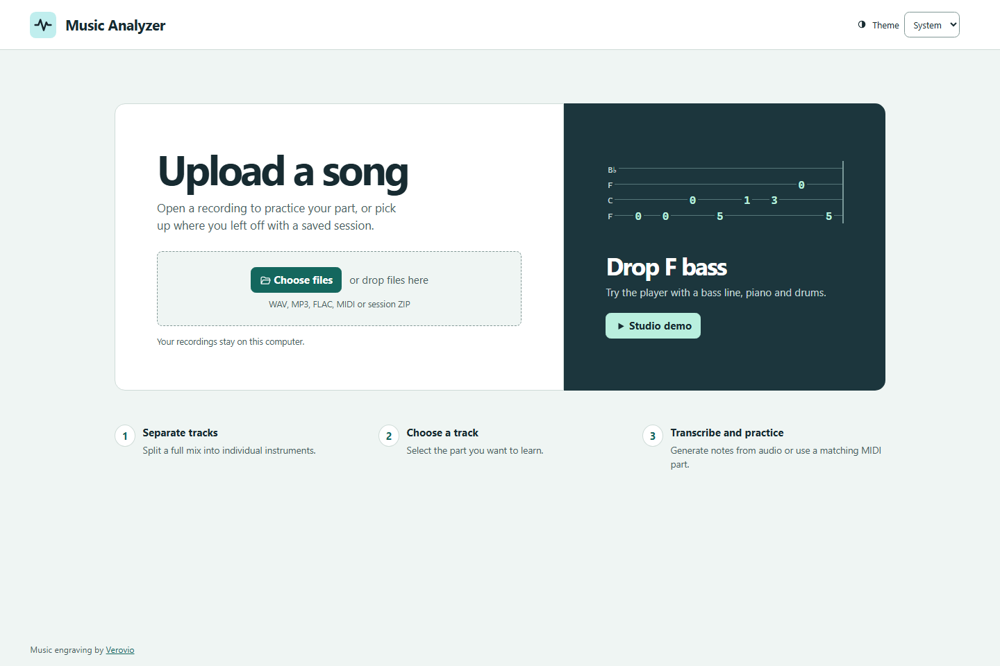
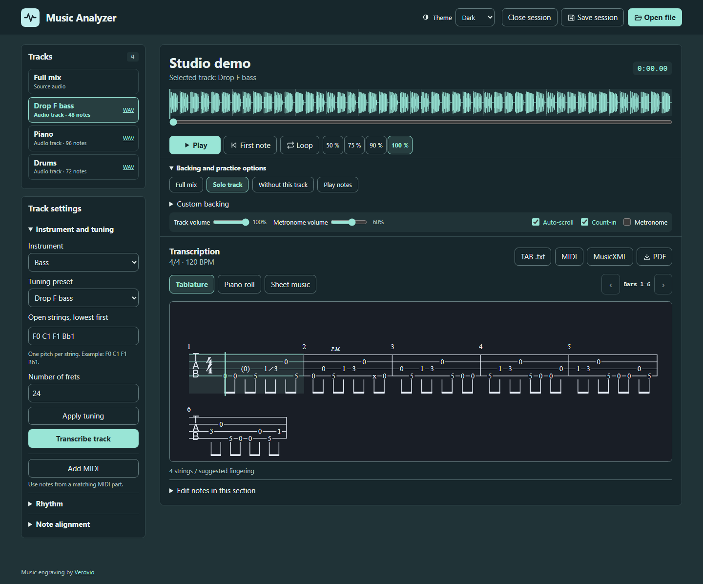
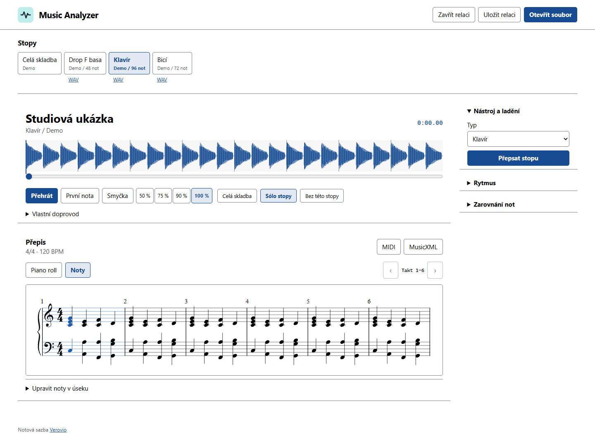
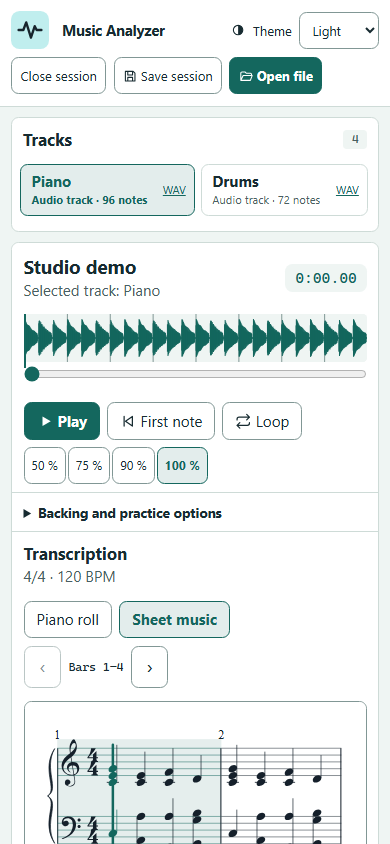

# Music Analyzer

[](https://github.com/Majkey25/music-analyzer/actions/workflows/ci.yml)
[](https://github.com/Majkey25/music-analyzer/actions/workflows/codeql.yml)
[](https://github.com/Majkey25/music-analyzer/releases/latest)
[](LICENSE)

Transcribe songs one track at a time and practice with your own tablature. Music Analyzer runs in your browser and processes files on your computer. Play the full mix, solo a part, or practice with backing tracks.





## Getting started

1. Download the ZIP from the [latest release](https://github.com/Majkey25/music-analyzer/releases/latest) and extract it.
2. Install [uv](https://docs.astral.sh/uv/getting-started/installation/) and [FFmpeg](https://ffmpeg.org/download.html). Check that `ffmpeg -version` works in a new terminal.
3. On Windows, run `Spustit.cmd`. On Linux or macOS, run the following from the project root.

   ```sh
   uv run --locked --no-dev --extra separation python -X utf8 .
   ```

The app opens your browser at `127.0.0.1`. Press Ctrl+C in the terminal to stop it. Setup downloads Python 3.12 and the dependencies. The first separation downloads the model weights. Once the weights are cached, you can work offline. Allow several GB of disk space and several minutes for separating a longer song on CPU.

Use **Theme** in the header to select light or dark mode or follow your system preference.

Dependencies are locked for Windows x64, Linux x64, and Apple Silicon macOS. Windows x64 has been verified. You can omit `--extra separation` if you only need MIDI or transcription of an isolated track.

## Transcribing

* **Full song** | Open a WAV, MP3, or FLAC file. Choose **Separate tracks**, select a track, and click **Transcribe track**. The model separates bass, drums, guitar, piano, vocals, and other audio. How well it can isolate an instrument depends on the mix.
* **Isolated instrument** | Choose an instrument and transcribe the track directly. Violin has a dedicated pitch range. For wind instruments and other pitched parts, choose **Other pitched instrument**. Choose **Drums** for kick, snare, hi-hat, and toms.
* **MIDI** | Open type 0 or 1 MIDI by itself or alongside audio. In an open session, **Add MIDI** imports its parts. **Use MIDI notes** copies the selected reference and any edits to the current audio stem while keeping its recording. MIDI keeps its original timing, including leading silence. Use **Note alignment** to adjust the offset or transposition.
* **Tuning** | Enter the open strings from lowest to highest, including the octave for each pitch. For example, use `F0 C1 F1 Bb1`. The pitches you enter determine the number of strings. Set your instrument's fret count, and use the note editor to choose a different playable string for any note.
* **Rhythm** | MIDI imports use the file's tempo and meter changes. For audio, the app estimates the tempo and first beat. Both the meter and the first beat can be corrected. The marker `3.1` means the first beat of bar three.
* **Score** | Tablature shows fret numbers on the strings and rhythmic stems and beams below. Piano uses a grand staff, and drums use percussion notation. Piano roll shows exact note onsets and durations, with keys for piano. Click a note or bar to seek there, or use Tab and Enter to select a bar. A moving playhead marks the current position.
* **Export** | MIDI preserves transcription timing and tempo and meter changes. MusicXML places notes, rests, chords, and ties on a sixteenth-note grid. In tablature view, it also includes tuning, strings, and frets. TAB .txt lists frets, times, and beats. **PDF** opens a print preview of all score pages. Choose **Save as PDF** in the print dialog.
* **Playing techniques** | Use the note editor to mark ghost notes, dead notes, slides into a note, and palm mutes on bass or guitar. Marks are written notation. Synthesized playback uses the notes' existing pitch, timing, and velocity.

## Practice and save

1. Select the part you want to read. **Full mix** plays the original audio. **Solo track** plays the selected part. **Without this track** mixes the remaining separated tracks for practice.
2. **Play notes** plays the transcription with synthesized sound. Use **Custom backing** to choose the audio tracks you want to hear together. Press Space to play and pause. **Auto-scroll** follows the active row and **Count-in** plays one bar of clicks aligned to the song. Both are on by default. **Metronome** is off by default. Its slider controls click and count-in volume independently of the track. Under **Rhythm**, set a negative metronome offset to move the clicks earlier. **Loop** can repeat the current bar or a range.
3. **Save session** downloads a `.music-analyzer.zip` file with the audio, selected track, note edits, tuning, rhythm grid, and playback settings. Reopen the intact archive through **Open file** on this computer or another.



<details>
<summary>Mobile layout</summary>



</details>

## Accuracy and privacy

Audio transcription estimates what was played. Distortion, short notes, bends, and dense chords may need manual correction. **Bass** mode follows a single bass line, including low tunings. Drum transcription estimates kick, snare, hi-hat, and tom hits from their attacks and frequency content. It can combine cymbal hits and simultaneous hits. When a pitch can be played on several strings, you can edit the fingering. Violin from a full mix may appear under **Other**.

The app processes audio on your computer without an account or remote storage. It keeps source recordings intact and stores working files in a local temporary folder until the session or app closes. The folder may remain if the app is forced to quit. The limits are 256 MB per import, 15 minutes per audio file, and 20,000 notes per track.

## Development and testing

```sh
uv sync --locked
uv run ruff check
uv run pyright
uv run python -m unittest discover -s tests
uv run python -m tests.model_checks
uv run playwright install chromium
uv run python -m tests.browser_checks
```

The core tests cover MIDI timing and sustain, rhythm, string assignment, drums, and score rendering. To try the UI, choose **Studio demo** for synthesized bass, piano, and drums.

Track separation uses [HTDemucs 6s](https://github.com/facebookresearch/demucs) through [demucs-infer](https://github.com/openmirlab/demucs-infer). Pitched instrument transcription uses [Spotify Basic Pitch](https://github.com/spotify/basic-pitch) with ONNX Runtime. Bass and drums use dedicated analyzers. [Verovio](https://www.verovio.org/) renders scores, and [librosa](https://librosa.org/) estimates tempo and beat positions.

## License

Source code is publicly available for personal use under a [proprietary license](LICENSE). Libraries, tools, and model weights have [their own terms](THIRD_PARTY.md). See the [changelog](CHANGELOG.md) for release history.
